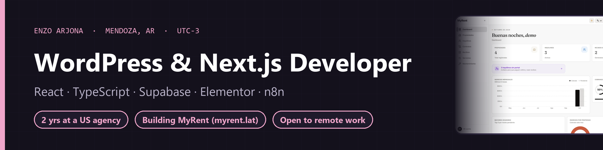

### Hi, I'm Enzo

WordPress and Next.js developer in Mendoza, Argentina (UTC-3), open to remote work as a contractor or full-time.

- **2 years at a US digital marketing agency**, fully remote: client sites in WordPress with Elementor, ACF Pro, Gravity Forms and WooCommerce, theme customizations with PHP hooks, landing pages, speed and on-page SEO.
- **Building [MyRent](https://github.com/ArjonaEnzo/myrent-overview)**, a multi-tenant rental-management SaaS in production with its first customer: Next.js 15, TypeScript, Supabase/PostgreSQL with Row Level Security, Mercado Pago webhooks, 500+ unit tests and Playwright E2E in CI.
- **Automations** with n8n and the Claude API: lead capture, notifications, AI summaries.

#### Stack

   
   
    

#### Featured

| Project | What it is | Stack |
|---|---|---|
| [MyRent](https://github.com/ArjonaEnzo/myrent-overview) | Rental-management SaaS in production ([myrent.lat](https://myrent.lat)) | Next.js · Supabase · RLS · Mercado Pago |
| [Portfolio](https://github.com/ArjonaEnzo/portfolio) | A walkable 3D room plus a classic text version, EN/ES ([live](https://enzo-arjona.vercel.app)) | Next.js · React Three Fiber · TypeScript |
| [Poke Battle](https://github.com/ArjonaEnzo/poke-battle-api) | Full-stack turn-based battle app with history ([client](https://github.com/ArjonaEnzo/poke-battle-client)) | NestJS · TypeORM · SQLite · React · MUI |

📫 [LinkedIn](https://www.linkedin.com/in/enzoarjona/) · [enzoarjona30@gmail.com](mailto:enzoarjona30@gmail.com) · [Portfolio](https://enzo-arjona.vercel.app) · [Resume](https://enzo-arjona.vercel.app/cv-enzo-arjona.pdf)
